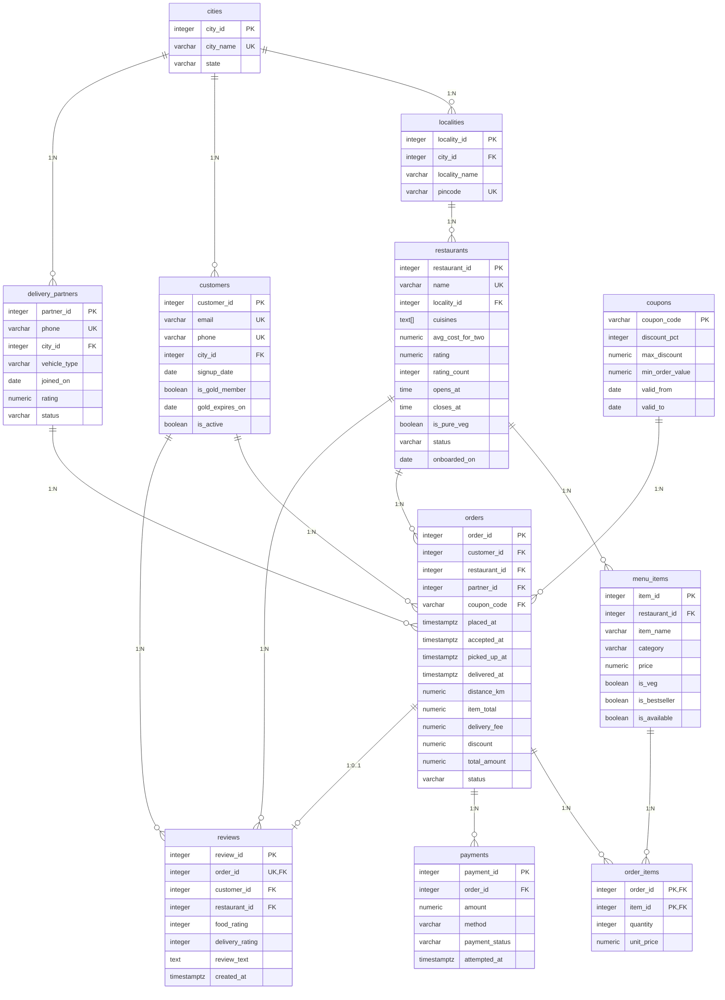

# Phase 2 — Schema Design

**Team T0022 (Section B)** · Zomato Food Delivery Database · DE_Project_2026

The schema was derived from the 11 CSV exports in `seed_data/` — nobody gave
us the `CREATE TABLE` statements. This document is the data dictionary, the ER
diagram, the functional-dependency / normal-form analysis, the integrity-check
results, and every data problem we found.

**Deliverables:** `sql/01_schema.sql` (DDL), `sql/02_load_data.sql` (load),
`sql/03_integrity_checks.sql` (verification).

**Verified:** `01_schema.sql` runs top-to-bottom on an empty database with no
errors; `02_load_data.sql` loads all 11 files with no errors and the row counts
match the brief exactly; all 30 queries in `queries/workload_30.sql` run
unchanged against the schema.

---

## 1. How to reproduce

```bash
createdb zomato
psql -d zomato -X -v ON_ERROR_STOP=1 -f sql/01_schema.sql
psql -d zomato -X -v ON_ERROR_STOP=1 -f sql/02_load_data.sql
psql -d zomato -X -f sql/03_integrity_checks.sql
```

`02_load_data.sql` begins with a `TRUNCATE ... CASCADE`, so it is safe to
re-run. It must be run from the project root because `\copy` resolves
`seed_data/...` on the client side.

---

## 2. Data dictionary

Every table lives in schema `zomato`. Types were chosen from the data, not
defaulted to `text`:

| Type | Used for | Why |
|------|----------|-----|
| `integer` | ids, counts, ratings 1–5, percentages | exact, small, whole |
| `numeric(10,2)` | money | exact to the paisa; `float` would break `total = item + fee − discount` |
| `numeric(3,1)` / `numeric(4,1)` | ratings, distance | one decimal place is all the data carries |
| `numeric(8,2)` | menu prices, coupon limits | smaller money columns |
| `varchar(n)` | names, codes, phone, pincode | bounded; enforces shape with CHECK |
| `text` | review free text | unbounded |
| `text[]` | `restaurants.cuisines` | the CSV already holds array literals; `= ANY` works natively |
| `boolean` | yes/no flags | CSV stores `t`/`f`, which PostgreSQL reads directly |
| `date` | signup, onboarded, joined, validity | no time component |
| `time` | `opens_at`, `closes_at` | daily schedule, no date |
| `timestamptz` | order/payment/review timestamps | CSV carries `+05:30`; keeps instants comparable |

### 2.1 `cities`

| Column | Type | Constraints | Why |
|--------|------|-------------|-----|
| `city_id` | integer | **PK**, NOT NULL, `> 0` | surrogate key from the export |
| `city_name` | varchar(50) | NOT NULL, **UNIQUE**, `length >= 2` | a city name is a natural key; 10 distinct values |
| `state` | varchar(50) | NOT NULL, `length >= 2` | free text, no controlled list |

### 2.2 `localities`

| Column | Type | Constraints | Why |
|--------|------|-------------|-----|
| `locality_id` | integer | **PK**, NOT NULL, `> 0` | surrogate key |
| `city_id` | integer | NOT NULL, **FK → cities**, `> 0` | many localities per city |
| `locality_name` | varchar(50) | NOT NULL | |
| `pincode` | varchar(6) | NOT NULL, **UNIQUE**, `~ '^[0-9]{6}$'` | Indian pincodes are exactly 6 digits; all 100 are distinct |
| | | **UNIQUE (locality_name, city_id)** | a locality name is unique *within* a city; names do not repeat across cities in this data, but the composite key is the correct rule |

### 2.3 `customers`

| Column | Type | Constraints | Why |
|--------|------|-------------|-----|
| `customer_id` | integer | **PK**, NOT NULL, `> 0` | surrogate key |
| `full_name` | varchar(80) | NOT NULL | |
| `email` | varchar(120) | NOT NULL, **UNIQUE**, regex | login identifier; 25,000 distinct values |
| `phone` | varchar(10) | NOT NULL, **UNIQUE**, `~ '^[0-9]{10}$'` | Indian mobile numbers; 25,000 distinct, no overlap with partner phones |
| `city_id` | integer | NOT NULL, **FK → cities**, `> 0` | home city |
| `signup_date` | date | NOT NULL | |
| `is_gold_member` | boolean | NOT NULL, default FALSE | |
| `gold_expires_on` | date | NULL allowed | **must be set iff Gold** (see CHECK) |
| `is_active` | boolean | NOT NULL, default TRUE | soft-delete flag |

**Gold rule:** `NOT is_gold_member OR gold_expires_on IS NOT NULL`. A Gold
member must carry an expiry date. The reverse direction is deliberately *not*
enforced — see data problem D2.

### 2.4 `restaurants`

| Column | Type | Constraints | Why |
|--------|------|-------------|-----|
| `restaurant_id` | integer | **PK**, NOT NULL, `> 0` | surrogate key |
| `name` | varchar(100) | NOT NULL, **UNIQUE** | 2,500 distinct names |
| `locality_id` | integer | NOT NULL, **FK → localities**, `> 0` | |
| `cuisines` | text[] | NOT NULL, `cardinality BETWEEN 1 AND 3` | 1–3 cuisines per restaurant; 10 distinct values |
| `avg_cost_for_two` | numeric(8,2) | NOT NULL, `> 0` | 200–1500 |
| `rating` | numeric(3,1) | NULL allowed, `1.0–5.0` | **nullable**: 124 restaurants have no rating |
| `rating_count` | integer | NOT NULL, default 0, `>= 0` | |
| `opens_at` | time | NOT NULL | 07:00, 10:00, 11:00 or 12:00 |
| `closes_at` | time | NOT NULL, `> opens_at` | 22:00–23:59 |
| `is_pure_veg` | boolean | NOT NULL, default FALSE | |
| `status` | varchar(20) | NOT NULL, IN (`OPEN`, `TEMPORARILY_CLOSED`, `DELISTED`) | |
| `onboarded_on` | date | NOT NULL | |

### 2.5 `menu_items`

| Column | Type | Constraints | Why |
|--------|------|-------------|-----|
| `item_id` | integer | **PK**, NOT NULL, `> 0` | surrogate key |
| `restaurant_id` | integer | NOT NULL, **FK → restaurants** ON DELETE CASCADE, `> 0` | a menu item dies with its restaurant |
| `item_name` | varchar(80) | NOT NULL | 40 distinct dish names |
| `category` | varchar(30) | NOT NULL, IN (`Main Course`, `Starters`, `Rice`, `Breads`, `Desserts`, `Beverages`) | 6 values |
| `price` | numeric(8,2) | NOT NULL, `> 0` | 28–588 |
| `is_veg` | boolean | NOT NULL, default TRUE | |
| `is_bestseller` | boolean | NOT NULL, default FALSE | |
| `is_available` | boolean | NOT NULL, default TRUE | |
| | | **UNIQUE (restaurant_id, item_name)** | a dish appears once per menu |

### 2.6 `delivery_partners`

| Column | Type | Constraints | Why |
|--------|------|-------------|-----|
| `partner_id` | integer | **PK**, NOT NULL, `> 0` | surrogate key |
| `full_name` | varchar(80) | NOT NULL | 100 distinct names, reused |
| `phone` | varchar(10) | NOT NULL, **UNIQUE**, `~ '^[0-9]{10}$'` | 2,000 distinct |
| `city_id` | integer | NOT NULL, **FK → cities**, `> 0` | |
| `vehicle_type` | varchar(15) | NOT NULL, IN (`BIKE`, `SCOOTER`, `EV`, `BICYCLE`) | 4 values |
| `joined_on` | date | NOT NULL | |
| `rating` | numeric(3,1) | NOT NULL, `1.0–5.0` | 3.4–5.0 |
| `status` | varchar(15) | NOT NULL, IN (`ACTIVE`, `INACTIVE`, `BLOCKED`) | |

### 2.7 `coupons`

| Column | Type | Constraints | Why |
|--------|------|-------------|-----|
| `coupon_code` | varchar(20) | **PK** | natural key; 30 codes, all uppercase alphanumeric |
| `discount_pct` | integer | NOT NULL, `1–100` | 20, 30, 40, 50, 60 |
| `max_discount` | numeric(8,2) | NOT NULL, `> 0` | 80–150 |
| `min_order_value` | numeric(8,2) | NOT NULL, `> 0` | 149–299 |
| `valid_from` | date | NOT NULL | |
| `valid_to` | date | NOT NULL, `>= valid_from` | |

### 2.8 `orders`

| Column | Type | Constraints | Why |
|--------|------|-------------|-----|
| `order_id` | integer | **PK**, NOT NULL, `> 0` | surrogate key |
| `customer_id` | integer | NOT NULL, **FK → customers** ON DELETE RESTRICT, `> 0` | |
| `restaurant_id` | integer | NOT NULL, **FK → restaurants** ON DELETE RESTRICT, `> 0` | |
| `partner_id` | integer | NULL allowed, **FK → delivery_partners** ON DELETE SET NULL, `> 0` | **nullable**: 13,538 orders unassigned |
| `coupon_code` | varchar(20) | NULL allowed, **FK → coupons** ON DELETE SET NULL | **nullable**: 129,792 orders have no coupon |
| `placed_at` | timestamptz | NOT NULL | |
| `accepted_at` | timestamptz | NULL allowed | set iff status ≥ ACCEPTED |
| `picked_up_at` | timestamptz | NULL allowed | set iff status ≥ OUT_FOR_DELIVERY |
| `delivered_at` | timestamptz | NULL allowed | set iff status = DELIVERED |
| `distance_km` | numeric(4,1) | NOT NULL, `> 0 AND <= 50` | 1.0–9.5 |
| `item_total` | numeric(10,2) | NOT NULL, `>= 0` | |
| `delivery_fee` | numeric(10,2) | NOT NULL, `>= 0` | |
| `discount` | numeric(10,2) | NOT NULL, default 0, `>= 0` | |
| `total_amount` | numeric(10,2) | NOT NULL, `>= 0` | |
| `status` | varchar(25) | NOT NULL, IN (7 statuses) | |

**Money rule:** `total_amount = item_total + delivery_fee − discount`.
Verified on all 150,000 rows with zero violations.

**Lifecycle rule:** `placed_at <= accepted_at <= picked_up_at <= delivered_at`,
each comparison applied only when both sides are present. Zero violations.

**Status-dependent NULL rules** (each verified on all 150,000 rows):

| status | partner_id | accepted_at | picked_up_at | delivered_at |
|--------|:----------:|:-----------:|:------------:|:------------:|
| `PLACED` | NULL | NULL | NULL | NULL |
| `ACCEPTED` | NULL | set | NULL | NULL |
| `PREPARING` | set | set | NULL | NULL |
| `OUT_FOR_DELIVERY` | set | set | set | NULL |
| `DELIVERED` | set | set | set | set |
| `CANCELLED_BY_CUSTOMER` | either | either | NULL | NULL |
| `CANCELLED_BY_RESTAURANT` | NULL | NULL | NULL | NULL |

These are encoded as six CHECK constraints. The `CANCELLED_BY_CUSTOMER` row is
the interesting one: 5,974 such orders have a partner and an acceptance time
(cancelled after assignment), 6,040 have neither (cancelled before). Both are
valid, so the constraint only forbids a pickup or a delivery time.

### 2.9 `order_items`

| Column | Type | Constraints | Why |
|--------|------|-------------|-----|
| `order_id` | integer | **PK (order_id, item_id)**, **FK → orders** ON DELETE CASCADE | |
| `item_id` | integer | **PK (order_id, item_id)**, **FK → menu_items** ON DELETE RESTRICT | |
| `quantity` | integer | NOT NULL, `> 0` | 1, 2 or 3 |
| `unit_price` | numeric(10,2) | NOT NULL, `>= 0` | |

**Primary key is composite.** A dish can appear on many orders and an order has
many dishes (M:N), so neither column alone is unique. 375,000 rows, 375,000
distinct `(order_id, item_id)` pairs — the composite key holds. `order_id` alone
is not unique (1–4 lines per order) and `item_id` alone is not unique (each dish
is ordered many times).

**Cross-table rule:** the dish on a line must belong to the restaurant that
received the order. Verified on all 375,000 rows. PostgreSQL forbids subqueries
in `CHECK`, so this is enforced by a `BEFORE INSERT/UPDATE` trigger that raises
`check_violation`.

### 2.10 `payments`

| Column | Type | Constraints | Why |
|--------|------|-------------|-----|
| `payment_id` | integer | **PK**, NOT NULL, `> 0` | surrogate key |
| `order_id` | integer | NOT NULL, **FK → orders** ON DELETE CASCADE, `> 0` | |
| `amount` | numeric(10,2) | NOT NULL, `>= 0` | |
| `method` | varchar(10) | NOT NULL, IN (`UPI`, `CARD`, `COD`, `WALLET`) | 4 values |
| `payment_status` | varchar(10) | NOT NULL, IN (`SUCCESS`, `FAILED`, `REFUNDED`) | 3 values |
| `attempted_at` | timestamptz | NOT NULL | |

**`order_id` is not unique.** An order can have more than one payment attempt:
6,965 orders have a FAILED attempt followed by a SUCCESS one, and 76 have FAILED
then REFUNDED. So `payment_id` is the primary key, and there is no unique
constraint on `order_id`. This is exactly the case the brief asks us to look
for.

**Cross-table rule:** `amount <= orders.total_amount`. Verified on all 137,378
rows; enforced by trigger.

### 2.11 `reviews`

| Column | Type | Constraints | Why |
|--------|------|-------------|-----|
| `review_id` | integer | **PK**, NOT NULL, `> 0` | surrogate key |
| `order_id` | integer | NOT NULL, **UNIQUE**, **FK → orders** ON DELETE CASCADE | one review per order |
| `customer_id` | integer | NOT NULL, **FK → customers** ON DELETE RESTRICT | denormalised from the order |
| `restaurant_id` | integer | NOT NULL, **FK → restaurants** ON DELETE RESTRICT | denormalised from the order |
| `food_rating` | integer | NOT NULL, `1–5` | |
| `delivery_rating` | integer | NULL allowed, `1–5` | **nullable**: 7,741 reviews have no delivery rating |
| `review_text` | text | NULL allowed | **nullable**: 21,405 reviews have no text |
| `created_at` | timestamptz | NOT NULL | |

**`order_id` is UNIQUE** — 39,186 reviews, 39,186 distinct orders, at most one
review per order.

**Cross-table rules** (all verified on 39,186 rows, all enforced by trigger):
the review must be for a delivered order; `created_at >= delivered_at`; the
reviewer must be the order's customer; the restaurant must be the order's
restaurant.

---

## 3. Constraints — the full list

**66 CHECK constraints** (the brief asks for at least 12), **11 primary keys**,
**9 UNIQUE constraints**, **15 foreign keys**, **74 NOT NULL columns**.

| Table | PK | UNIQUE | FK | CHECK |
|-------|:--:|:------:|:--:|:-----:|
| cities | 1 | 1 | 0 | 3 |
| localities | 1 | 2 | 1 | 3 |
| customers | 1 | 2 | 1 | 6 |
| restaurants | 1 | 1 | 1 | 8 |
| menu_items | 1 | 1 | 1 | 4 |
| delivery_partners | 1 | 1 | 1 | 6 |
| coupons | 1 | 0 | 0 | 4 |
| orders | 1 | 0 | 4 | 19 |
| order_items | 1 | 0 | 2 | 2 |
| payments | 1 | 0 | 1 | 5 |
| reviews | 1 | 1 | 3 | 6 |
| **Total** | **11** | **9** | **15** | **66** |

### 3.1 CHECK constraints, grouped by the rule they encode

**Allowed values (statuses, categories, methods, vehicle types)** — 6:
`restaurants.status`, `menu_items.category`, `delivery_partners.vehicle_type`,
`delivery_partners.status`, `payments.method`, `payments.payment_status`,
`orders.status`.

**Ranges (ratings, distance, percentages)** — 8:
`restaurants.rating 1–5`, `delivery_partners.rating 1–5`,
`reviews.food_rating 1–5`, `reviews.delivery_rating 1–5`,
`orders.distance_km > 0 AND <= 50`, `coupons.discount_pct 1–100`,
`coupons.max_discount > 0`, `coupons.min_order_value > 0`.

**Time order** — 1 table-level rule plus 6 status-dependent rules:
`orders_time_order_check` (placed ≤ accepted ≤ picked ≤ delivered), and
`orders_placed_nulls_check`, `orders_accepted_nulls_check`,
`orders_preparing_nulls_check`, `orders_out_for_delivery_nulls_check`,
`orders_delivered_nulls_check`, `orders_cancelled_nulls_check`,
`orders_cancelled_by_restaurant_nulls_check`.

**Money rules** — 4:
`orders_total_amount_rule_check` (`total = item + fee − discount`),
`orders_item_total_check`, `orders_delivery_fee_check`, `orders_discount_check`,
`orders_total_amount_check`, `payments_amount_check`,
`menu_items_price_check`.

**Status/method-dependent rules** — 3:
`orders_cancelled_by_restaurant_nulls_check` (a rejection precedes acceptance),
`orders_cancelled_nulls_check` (a cancellation never has a pickup/delivery time),
`restaurants_hours_check` (`closes_at > opens_at`).

**Shape rules (regex, cardinality)** — 8:
`customers_email_check`, `customers_phone_check`,
`delivery_partners_phone_check`, `localities_pincode_check`,
`restaurants_cuisines_check` (cardinality 1–3), plus the `> 0` id checks.

**Cross-field consistency** — 4:
`customers_gold_expiry_check`, `customers_gold_expiry_after_signup_check`,
`coupons_validity_check` (`valid_to >= valid_from`),
`restaurants_rating_check`.

### 3.2 Foreign keys and their delete rules

| FK | ON DELETE | Why |
|----|-----------|-----|
| `localities → cities` | **RESTRICT** | a city with localities cannot be deleted; reassign them first |
| `customers → cities` | **RESTRICT** | a city with customers cannot be deleted |
| `restaurants → localities` | **RESTRICT** | a locality with restaurants cannot be deleted |
| `menu_items → restaurants` | **CASCADE** | a menu item has no meaning without its restaurant |
| `menu_items → orders` (via `order_items`) | **RESTRICT** | never delete a dish that appears on an order |
| `delivery_partners → cities` | **RESTRICT** | |
| `orders → customers` | **RESTRICT** | orders are legal/financial records; never silently drop them |
| `orders → restaurants` | **RESTRICT** | |
| `orders → delivery_partners` | **SET NULL** | a partner leaving must not delete the order; it just becomes unassigned |
| `orders → coupons` | **SET NULL** | a retired coupon must not delete the order |
| `order_items → orders` | **CASCADE** | lines have no meaning without the header |
| `payments → orders` | **CASCADE** | a payment attempt belongs to its order |
| `reviews → orders` | **CASCADE** | a review belongs to its order |
| `reviews → customers` | **RESTRICT** | |
| `reviews → restaurants` | **RESTRICT** | |

All FKs use `ON UPDATE CASCADE` so that a corrected key propagates.

The pattern: **CASCADE for dependent detail rows** (order lines, payments,
reviews, menu items) whose parent is the *owner*; **RESTRICT for reference
data** (cities, localities, restaurants, customers, partners) that other rows
merely point at; **SET NULL for optional links** (partner, coupon) where the
order should survive the loss.

### 3.3 Cross-table rules enforced by triggers

PostgreSQL does not allow subqueries in `CHECK` constraints, so four rules that
need to read another table are enforced by `BEFORE INSERT/UPDATE` triggers.
They run in the same transaction, raise `check_violation` (or
`foreign_key_violation`), and are therefore exactly as atomic as a constraint:

| Trigger | Rule | Verified violations in seed data |
|---------|------|:--------------------------------:|
| `orders_coupon_min_order_trigger` | `item_total >= coupons.min_order_value` | 0 of 20,208 |
| `payments_amount_trigger` | `amount <= orders.total_amount` | 0 of 137,378 |
| `order_items_restaurant_trigger` | line's dish belongs to the order's restaurant | 0 of 375,000 |
| `reviews_order_trigger` | delivered order, after delivery, correct customer and restaurant | 0 of 39,186 |

---

## 4. ER diagram



### Cardinalities

| Relationship | Cardinality | Evidence in the data |
|--------------|-------------|----------------------|
| cities → localities | 1:N | 100 localities, 10 per city |
| cities → customers | 1:N | 25,000 customers, 1–19 orders each |
| cities → delivery_partners | 1:N | 2,000 partners |
| localities → restaurants | 1:N | 2,500 restaurants across 100 localities |
| restaurants → menu_items | 1:N | exactly 20 dishes per restaurant |
| restaurants → orders | 1:N | 37–90 orders per restaurant |
| restaurants → reviews | 1:N | 4–31 reviews per restaurant |
| customers → orders | 1:N | 1–19 orders per customer |
| customers → reviews | 1:N | 1–9 reviews per customer |
| delivery_partners → orders | 1:N | 42–96 orders per partner |
| coupons → orders | 1:N | 20,208 orders use a coupon |
| orders → order_items | 1:N | 1–4 lines per order |
| orders → payments | 1:N | 1–2 attempts per order |
| orders → reviews | 1:0..1 | at most one review per order |
| menu_items → order_items | 1:N | each dish appears on many orders |
| orders ↔ menu_items | M:N | resolved by `order_items` |

---

## 5. Functional dependencies and normal form

### 5.1 Per-table FDs

**cities**: `city_id → city_name, state`; `city_name → city_id, state`.
`city_id` is the PK and `city_name` is a candidate key. Every non-key attribute
depends on the whole key and on nothing else → **BCNF**.

**localities**: `locality_id → city_id, locality_name, pincode`;
`pincode → locality_id, …`; `(locality_name, city_id) → locality_id, pincode`.
Three candidate keys, all non-key attributes dependent on each → **BCNF**.

**customers**: `customer_id → full_name, email, phone, city_id, signup_date,
is_gold_member, gold_expires_on, is_active`; `email → customer_id, …`;
`phone → customer_id, …`. Three candidate keys → **BCNF**.

**restaurants**: `restaurant_id → name, locality_id, cuisines, avg_cost_for_two,
rating, rating_count, opens_at, closes_at, is_pure_veg, status, onboarded_on`;
`name → restaurant_id, …`. Two candidate keys → **BCNF**.

**menu_items**: `item_id → restaurant_id, item_name, category, price, is_veg,
is_bestseller, is_available`; `(restaurant_id, item_name) → item_id, …`.
Two candidate keys → **BCNF**.

**delivery_partners**: `partner_id → full_name, phone, city_id, vehicle_type,
joined_on, rating, status`; `phone → partner_id, …` → **BCNF**.

**coupons**: `coupon_code → discount_pct, max_discount, min_order_value,
valid_from, valid_to` → **BCNF**.

**orders**: `order_id → customer_id, restaurant_id, partner_id, coupon_code,
placed_at, accepted_at, picked_up_at, delivered_at, distance_km, item_total,
delivery_fee, discount, total_amount, status`. `order_id` is the only key →
**BCNF**.

**order_items**: `(order_id, item_id) → quantity, unit_price`. The key is
composite and `quantity`/`unit_price` depend on the *whole* key (a dish's price
on a line depends on both which order and which dish) → **2NF satisfied**, and
there are no transitive dependencies → **3NF / BCNF**.

**payments**: `payment_id → order_id, amount, method, payment_status,
attempted_at` → **BCNF**.

**reviews**: `review_id → order_id, customer_id, restaurant_id, food_rating,
delivery_rating, review_text, created_at`; `order_id → review_id, …` → **BCNF**.

### 5.2 Derived and redundant columns

The brief asks us to point out columns that are derivable, and to justify
keeping them.

| Column | Derivable from | Verdict |
|--------|----------------|---------|
| `orders.total_amount` | `item_total + delivery_fee − discount` | **Keep.** It is the amount actually charged, and it is what every bill and revenue query reads. We enforce the relationship with a CHECK so the cache can never drift. |
| `orders.item_total` | `sum(order_items.quantity × order_items.unit_price)` | **Keep.** Verified equal on all 150,000 orders. It is the pre-discount basket value and is needed for coupon eligibility; recomputing it per request would force a join and an aggregation on the hottest table. |
| `restaurants.rating` | `round(avg(reviews.food_rating), 1)` | **Keep, but it is stale.** R01 sorts the home feed by rating and cannot aggregate 39,186 reviews per request. It is refreshed nightly by W04. **In the seed data it does not match the reviews** — see D4. |
| `restaurants.rating_count` | `count(reviews)` | **Keep**, same reason. Also stale — see D4. |
| `restaurants.is_pure_veg` | `bool_and(menu_items.is_veg)` | **Keep.** Verified consistent on all 500 pure-veg restaurants (no non-veg dish). It is a filter on the home feed and must be readable without touching the menu. |
| `reviews.customer_id` | `orders.customer_id` | **Keep.** Verified equal on all 39,186 rows. It lets support search reviews by customer without a join, and we enforce agreement with a trigger. |
| `reviews.restaurant_id` | `orders.restaurant_id` | **Keep.** Verified equal on all 39,186 rows. R18 and R19 filter reviews by restaurant; the denormalised column avoids a join to a 150,000-row table. |
| `order_items.unit_price` | `menu_items.price` | **Keep.** Verified equal on all 375,000 rows. It is a *historical* price: a menu price can change tomorrow, but a past order must keep the price the customer actually paid. This is the textbook justification for copying a value instead of joining. |

The general rule we applied: **a derived column is kept when it is read on a
hot path and recomputing it would be more expensive than storing it, provided
the relationship to its source is enforced or its refresh is documented.**
`total_amount`, `item_total`, `rating`, `rating_count`, `is_pure_veg` all meet
that bar. `unit_price` meets it for a different reason — it is a snapshot, not
a cache.

---

## 6. Integrity checks — results

`sql/03_integrity_checks.sql` runs 17 checks. Every "violations" column must be
0. Results on the seed data:

| # | Check | Result |
|---|-------|--------|
| IC1 | every order line's dish belongs to the order's restaurant | **0** violations (375,000 lines) |
| IC2 | delivered orders with exactly one SUCCESS payment | 129,109 with one, **0** with zero, **0** with many |
| IC2b | delivered orders with no SUCCESS payment, by status | 1,304 REFUNDED, 76 FAILED — see D3 |
| IC2c | every delivered order has at least one payment attempt | **0** violations |
| IC2d | every delivered order has at most one SUCCESS payment | **0** violations |
| IC3 | a pure-veg restaurant has no non-veg dish | **0** violations (500 restaurants) |
| IC4 | `item_total = sum(quantity × unit_price)` | **0** violations (150,000 orders) |
| IC5 | `total_amount = item_total + delivery_fee − discount` | **0** violations |
| IC6 | `unit_price` matches the dish's menu price | **0** violations (375,000 lines) |
| IC7 | reviews: delivered order, correct customer and restaurant, after delivery | **0** in all four columns |
| IC8 | payment amount equals its order's total | **0** violations |
| IC9 | lifecycle timestamps monotonic | **0** in all four columns |
| IC10 | status-dependent NULL rules | **0** in all six columns |
| IC11 | delivery fee rule (Gold free; non-Gold 45 if > 5 km else 25) | **0** violations |
| IC12 | coupon discount rule `min(pct × item_total / 100, max_discount)` | **0** violations |
| IC13 | coupon used only above its minimum order value | **0** violations |
| IC14 | referential integrity — orphan rows | **0** in all 13 columns |
| IC15 | duplicate natural keys | **0** in all 6 columns |
| IC16 | data-quality defects | see §7 |
| IC17 | row counts vs the brief | **all 11 match exactly** |

### Row counts (IC17)

| Table | Loaded | Expected |
|-------|-------:|---------:|
| cities | 10 | 10 |
| localities | 100 | 100 |
| customers | 25,000 | 25,000 |
| restaurants | 2,500 | 2,500 |
| menu_items | 50,000 | 50,000 |
| delivery_partners | 2,000 | 2,000 |
| coupons | 30 | 30 |
| orders | 150,000 | 150,000 |
| order_items | 375,000 | 375,000 |
| payments | 137,378 | 137,378 |
| reviews | 39,186 | 39,186 |

---

## 7. Data problems found

These are defects in the seed data, not in our schema. We report them rather
than rejecting the rows, because the brief requires the schema to accept all
rows and because the 30 queries must run against the data as given.

**D1 — 124 restaurants have no rating.** All 124 have `rating_count > 0`, so
they carry a review count but no computed rating. Split by status: 110 are
`OPEN`, 7 are `TEMPORARILY_CLOSED`, 7 are `DELISTED`. Only 7 of the 124 have
no reviews at all; the other 117 have reviews but a NULL rating. `rating` is
nullable in our schema, so this loads cleanly. R01 sorts with `NULLS LAST`, so
these fall to the bottom of the home feed — which is the correct behaviour for
an unrated restaurant.

**D2 — 2 restaurants have a rating but `rating_count = 0`** (restaurants 1770
and 2166, both OPEN). This is internally contradictory: a rating implies at
least one review. We initially wrote a CHECK to forbid it and the load failed
on exactly these two rows. We removed the CHECK and report the defect instead,
because the brief requires all rows to load. W04 would fix both rows on the
next nightly run.

**D3 — 1,304 delivered orders have no SUCCESS payment.** All 1,304 have a
REFUNDED payment (1,228 REFUNDED only, 76 FAILED then REFUNDED). This is a
genuine business case — the order was delivered, then refunded — so it is not a
defect, but it means the intuitive rule "every delivered order has exactly one
successful payment" is **false**. Our schema encodes the correct rule instead:
at least one payment attempt, at most one SUCCESS.

**D4 — `restaurants.rating` and `rating_count` do not match `reviews`.** Of the
2,390 restaurants that have reviews, **all 2,390** have a `rating_count` that
differs from `count(reviews)`, and **2,271** have a `rating` that differs from
`round(avg(food_rating), 1)`. The values are plausible (3.1–5.0) but they are
not derived from the review rows in this export. This is exactly what W04
exists to fix. We keep the columns (the home feed needs them) and document
that they are a cache refreshed nightly, not the source of truth.

**D5 — 1,230 Gold members have already expired** (`gold_expires_on < 2026-07-01`)
but still have `is_gold_member = TRUE`. Relative to the data's "current" date
of 30 June 2026, these memberships should have lapsed. W05 is the nightly job
that fixes this. Our schema permits it because the brief requires the load to
succeed and because W05 must be able to run.

**D6 — 210 Gold members are also `is_active = FALSE`.** A lapsed/inactive
account flagged as Gold. Same treatment as D5.

**D7 — 7,741 reviews have no `delivery_rating`** and **21,405 have no
`review_text`**. Both columns are nullable. The empty CSV fields load as NULL,
which is correct: a customer can rate the food without rating the delivery, and
can leave a rating without writing text.

**D8 — 19,587 orders have no payment row at all.** These are exactly the
non-delivered orders (12,014 cancelled by customer, 7,423 cancelled by
restaurant, 38 placed, 37 accepted, 37 preparing, 38 out for delivery). An
order that was never completed has no payment, which is correct. Our schema
does not require a payment for non-delivered orders.

**D9 — 73 customers have never placed an order**, and **110 restaurants have
never received one**. Both are harmless: the schema does not require a customer
to have orders or a restaurant to have orders.

**D10 — `review_text` is drawn from only 12 distinct sentences** (plus NULL).
Real review text would be far more varied; this is synthetic data. It does not
affect the schema, but it means R18's `ILIKE '%cold%'` / `ILIKE '%late%'` filter
matches a large, predictable share of rows (2,924 of 39,186) rather than a rare
subset. Worth knowing when interpreting Phase 3 timings.

---

## 8. Indexes present after this phase

The brief forbids creating any index beyond the automatic ones in Phase 2.
PostgreSQL creates one index per PRIMARY KEY and per UNIQUE constraint:

```
cities_pkey                      cities_city_name_key
localities_pkey                  localities_pincode_key
                                 localities_locality_name_city_key
customers_pkey                   customers_email_key
                                 customers_phone_key
restaurants_pkey                 restaurants_name_key
menu_items_pkey                  menu_items_restaurant_item_key
delivery_partners_pkey           delivery_partners_phone_key
coupons_pkey
orders_pkey
order_items_pkey                 (composite: order_id, item_id)
payments_pkey
reviews_pkey                     reviews_order_id_key
```

**20 indexes, all from constraints** (11 primary-key indexes + 9 unique
indexes). No secondary index exists, so the Phase 3 baseline reflects a
genuinely untuned database. The one composite index worth noting is
`order_items_pkey (order_id, item_id)`: it serves the bill page (R24) and every
order→lines lookup, but it does *not* serve menu-item→orders lookups, because
`item_id` is the second column.

---

## 9. What this schema deliberately does not do

- **No secondary indexes.** That is Phase 4's job, and the baseline must be
  honest.
- **No partitioning.** Phase 5 designs it; the seed data is too small to
  measure.
- **No materialised views or summary tables.** Phase 4 may add them for the
  heavy reports.
- **No `NOT NULL` on `orders.partner_id` or `orders.coupon_code`.** 13,538
  orders have no partner and 129,792 have no coupon; forcing a value would
  misrepresent the data.
- **No `NOT NULL` on `reviews.delivery_rating` or `reviews.review_text`.**
  7,741 and 21,405 rows respectively have no value.
- **No unique constraint on `payments.order_id`.** 6,965 orders have two
  attempts; a unique constraint would reject real data.
